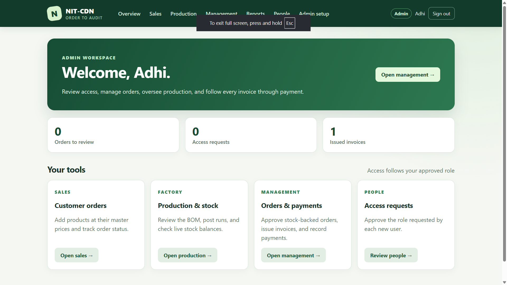
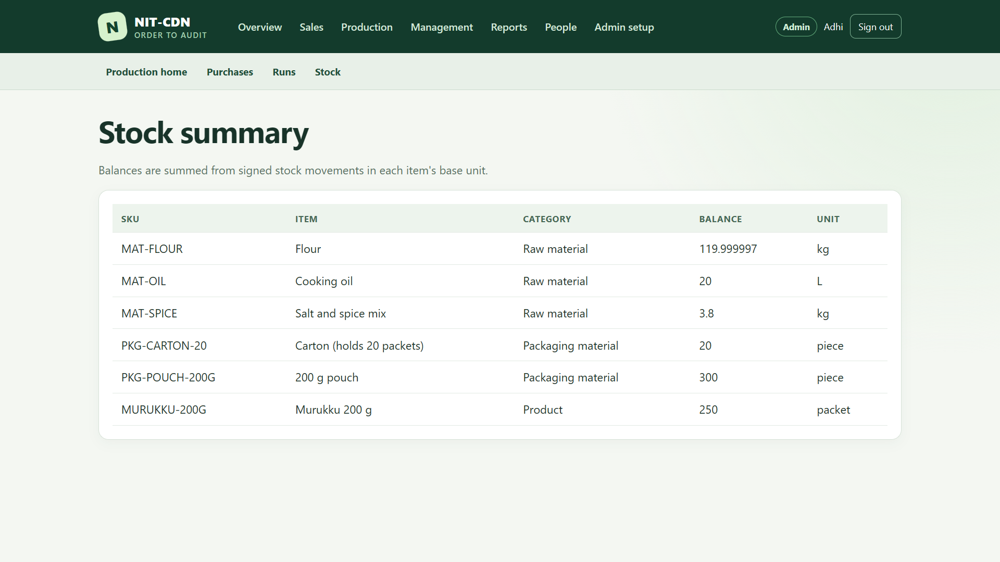
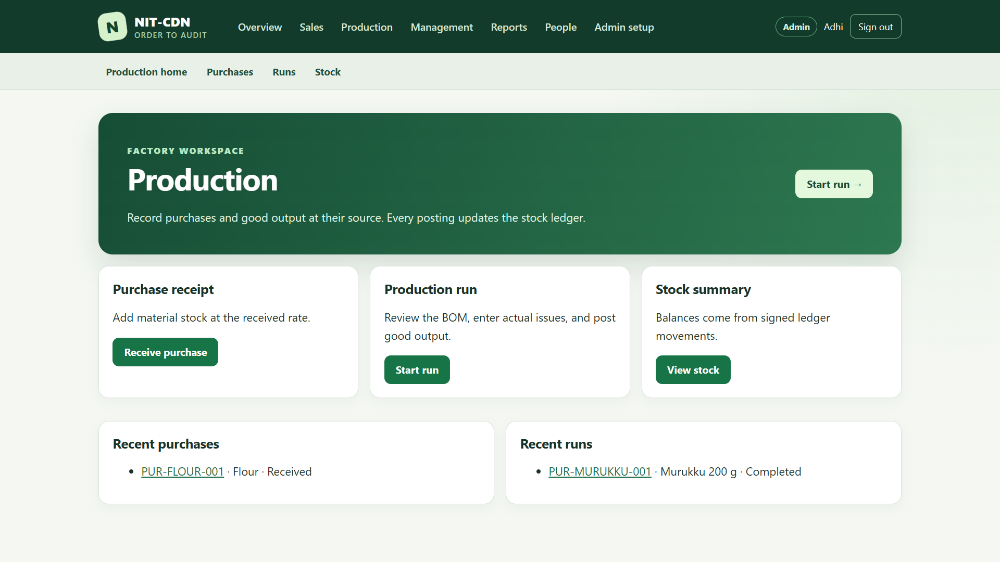
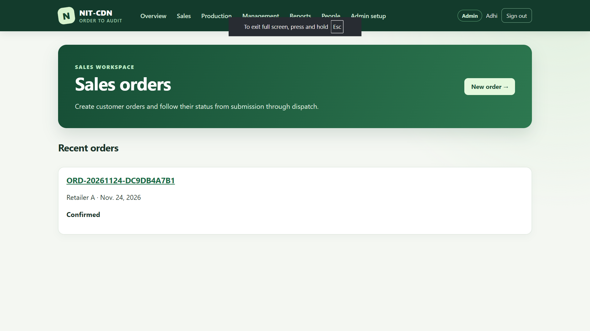
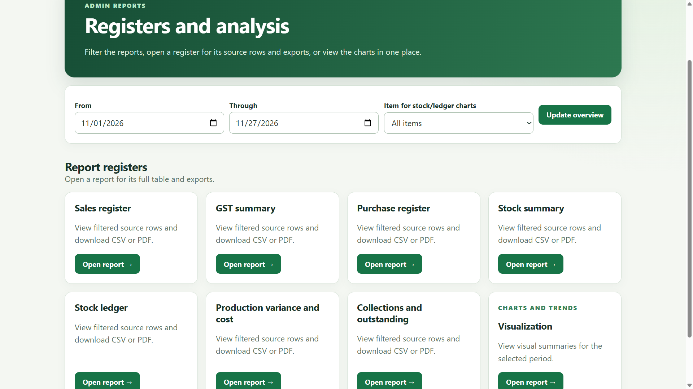
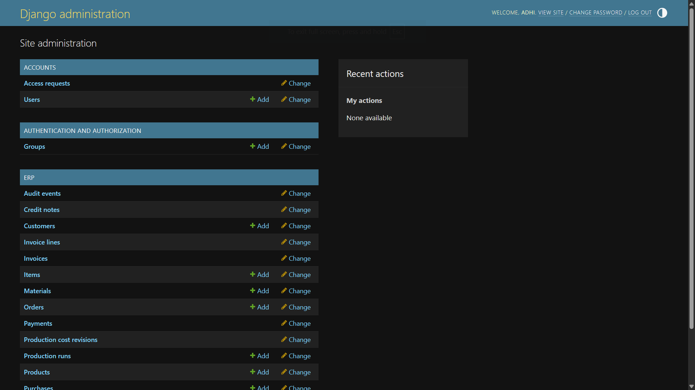

# NIT-CDN

**An order-to-audit ERP for small food manufacturers.**

NIT-CDN is a Django-based ERP application that connects customer orders, purchasing, production, inventory, GST invoicing, payments, and audit-ready reporting in a single workflow. Every stock movement, cost, and invoice is traceable to a source document and a user.

> **Project Status:** Working benchmark prototype. Configure and verify real GSTIN, HSN, company, and customer data before issuing business invoices. See [Current Limitations](#current-limitations).

## Live Demo

- **Live Application:** [Render URL](https://nit-cdn-demo.onrender.com)
- **GitHub Repository:** [NIT-CDN](https://github.com/Adhi-Keshavan/NIT-CDN.git)

---

## Table of Contents

- [Project Overview](#project-overview)
- [Technology Stack](#technology-stack)
- [Features](#features)
- [Application Screenshots](#application-screenshots)
- [System Architecture](#system-architecture)
- [Quick Start](#quick-start)
- [Configuration](#configuration)
- [Database Options](#database-options)
- [Demo Accounts and Access Control](#demo-accounts-and-access-control)
- [Benchmark Walkthrough](#benchmark-walkthrough)
- [Ledger and Costing Rules](#ledger-and-costing-rules)
- [Reports and Audit](#reports-and-audit)
- [Testing and Verification](#testing-and-verification)
- [Individual Contribution](#individual-contribution)
- [Documentation](#documentation)
- [Current Limitations](#current-limitations)
- [Future Improvements](#future-improvements)

---

## Project Overview

Small food manufacturers often manage customer orders, raw material purchases, production activities, inventory, invoices, and payments using separate systems or manual records.

NIT-CDN addresses this problem by bringing these operations into a unified ERP workflow.

The application provides centralized management of business operations while maintaining traceability across inventory movements, production costs, sales transactions, invoices, and audit events.

## Technology Stack

| Category | Technology |
|---|---|
| Backend | Python, Django |
| Frontend | HTML, CSS, JavaScript |
| Database | SQLite, PostgreSQL |
| Hosted Database | Supabase PostgreSQL |
| Deployment | Render |
| Version Control | Git, GitHub |

*Update this table if your actual implementation uses additional technologies.*

---

## Features

| Area | Capabilities |
|---|---|
| **Access Control** | Role-based workspaces for administrators, salespeople, and production staff. New signups stay inactive until administrator approval. |
| **Inventory** | Stock ledger of signed receipts and issues; balances are derived from posted movements. |
| **Production** | Batch requirements from a bill of materials (BOM), unit conversions, recorded yield and material variances. |
| **Costing** | Moving weighted-average material cost; production costs are snapshotted when a run is posted. |
| **Sales** | Order review and approval, stock checks, GST invoice PDFs, dispatch, payment collection, and credit notes. |
| **Reporting** | Date-filtered sales, GST, purchase, stock, production, and collections reports with CSV and PDF export. |
| **Audit** | User- and timestamp-stamped audit events for key posting and invoice actions. |

---

## Application Screenshots

The following screenshots demonstrate the major modules and workflows of the NIT-CDN ERP application.

### 1. Dashboard



### 2. Stock Management



### 3. Production Management



### 4. Sales and Order Management



### 5. Reports and Analytics



### 6. Admin


### 7. Salesman


> Add your actual application screenshots inside a folder named `screenshots` in the project root. Use the filenames specified above or update the image paths accordingly.

---

## System Architecture

NIT-CDN follows a Django-based application architecture.

```text
              User
               |
               v
       Frontend Interface
       (HTML, CSS, JS)
               |
               v
        Django Backend
               |
       -------------------
       |        |        |
       v        v        v
    Sales   Inventory  Production
       |        |        |
       -------------------
               |
               v
        Database Layer
       SQLite / PostgreSQL
               |
               v
       Reports and Audit
```

---

## Quick Start

### Requirements

- Python 3.10 or newer
- Windows PowerShell (commands below). macOS and Linux users can run equivalent Python commands.

### 1. Install

From the project folder:

```powershell
py -3 -m venv .venv
.\.venv\Scripts\python.exe -m pip install -r requirements.txt
Copy-Item .env.example .env
```

### 2. Configure

Edit `.env` and generate a private secret key:

```powershell
.\.venv\Scripts\python.exe -c "from django.core.management.utils import get_random_secret_key; print(get_random_secret_key())"
```

### 3. Run the Benchmark Demo

```powershell
powershell -ExecutionPolicy Bypass -File .\scripts\run_local.ps1
```

This command:

1. Uses an isolated local SQLite database (`db.local.sqlite3`).
2. Applies migrations.
3. Loads benchmark data.
4. Runs Django's system check.
5. Starts the development server.

Open http://127.0.0.1:8000/login/ and sign in using a demo account.

### Running Django Commands Manually

```powershell
.\.venv\Scripts\python.exe manage.py migrate
.\.venv\Scripts\python.exe manage.py seed_benchmark
.\.venv\Scripts\python.exe manage.py runserver
```

`seed_benchmark` is idempotent: re-running it updates benchmark records without creating duplicates.

---

## Configuration

Settings are read from `.env`. This file contains environment-specific secrets and must not be committed.

| Variable | Local Development Value | Notes |
|---|---|---|
| `SECRET_KEY` | Private random value | Generate using the command above. |
| `DEBUG` | `True` | Set to `False` in shared or production deployment. |
| `DATABASE_URL` | `sqlite:///db.sqlite3` | Use a PostgreSQL URI for Supabase. |

---

## Database Options

| Option | When to Use |
|---|---|
| Local SQLite | Demonstrations and evaluation |
| SQLite via `.env` | Manual local development |
| Supabase PostgreSQL | Hosted database |

### Using Supabase PostgreSQL

1. Open Connect in Supabase and copy the PostgreSQL connection URI.
2. Set the connection string in `.env`.
3. Replace the placeholders with your project values.
4. Apply migrations:

```powershell
.\.venv\Scripts\python.exe manage.py migrate
.\.venv\Scripts\python.exe manage.py seed_benchmark
```

Django migrations create the required tables.

---

## Demo Accounts and Access Control

The benchmark creates the following accounts.

**Demo Password:** `BenchmarkDemo2026!`

| Role | Username | Main Workspace |
|---|---|---|
| Admin | `factory_admin` | Overview, order review, access approvals, reports |
| Production | `production_supervisor` | Purchases, production runs, stock |
| Salesperson | `salesman_a` | Create orders and view own orders |
| Salesperson | `salesman_b` | Create orders and view own orders |

> **Security:** These are demo credentials. Replace them before exposing any deployment.

New signups remain inactive until an administrator approves them.

---

## Benchmark Walkthrough

The benchmark fixture creates:

- Murukku 200 g and its five BOM components.
- Two customers and four demo users.
- Opening stock dated 2026-11-01.
- Expected yield of 200 packets per batch.

### Part 1: Purchase and Production

1. Sign in as `production_supervisor`.
2. Receive 60 kg flour at ₹45/kg.
3. Start one Murukku 200 g production batch.
4. Record actual material usage and production yield.
5. Record labour and gas/power expenses.
6. Post the production run.

The benchmark records material and yield variances against configured thresholds.

### Part 2: Order, Invoice, Dispatch and Payment

1. Sign in as `salesman_a` and submit Retailer A's order.
2. Sign in as `factory_admin` and review the order.
3. Configure company and customer details.
4. Issue the GST invoice.
5. Dispatch the order.
6. Record the customer payment.

A second salesperson can submit an order that demonstrates how the system handles insufficient stock.

---

## Ledger and Costing Rules

- **Signed Movements:** Positive quantities add stock; negative quantities remove stock.
- **Derived Balances:** Stock balances are calculated from posted movements.
- **Safe Posting:** Purchases, production runs, adjustments, and dispatches post transactionally.
- **Costing:** Production material issues use moving weighted-average cost.
- **Wastage:** Wastage is included in the quantity issued.
- **Alerts:** Material and yield alerts trigger when the configured variance threshold is exceeded.

---

## Reports and Audit

Administrators can access reports through the Reports section.

Available reports include:

| Report | Purpose |
|---|---|
| Sales Register | Invoiced sales for the period |
| GST Summary | Tax collected by component |
| Purchase Register | Material receipts and costs |
| Stock Summary | Opening stock, movements, and closing stock |
| Stock Ledger | Movement-level inventory details |
| Production Variance/Cost | Yield and material variances |
| Collections/Outstanding | Payments received and balances due |

Reports support CSV and PDF exports.

### Invoice Integrity

- Issued invoices preserve seller, customer, HSN, price, and tax information.
- Invoices cannot be silently edited or deleted through the application.
- Administrators can issue dated, reasoned full credit notes for unpaid invoices.

### Audit Trail

Key posting and invoice actions record the acting user and timestamp, supporting transaction traceability.

---

## Testing and Verification

Run the following commands from PowerShell:

```powershell
.\.venv\Scripts\python.exe manage.py check

.\.venv\Scripts\python.exe manage.py makemigrations --check --dry-run

$env:DATABASE_URL = "sqlite:///db.tests.sqlite3"

.\.venv\Scripts\python.exe manage.py test

Remove-Item Env:DATABASE_URL
```

The test suite covers role access, stock posting, production benchmarks, order and invoice totals, dispatch, payments, report exports, audit events, and invoice immutability.

---

## Individual Contribution

My work on NIT-CDN involved developing and integrating the ERP application's core business workflows.

Key areas of contribution:

- Application development using Python and Django.
- Implementation of inventory tracking and stock management workflows.
- Development of production workflows and costing calculations.
- Integration of sales, order management, and invoicing functionalities.
- Implementation of reporting and audit-related features.
- Database integration and application deployment.

---

## Documentation

- **Design Note:** `docs/DESIGN_NOTE.md` – Schema overview, unit-conversion assumptions, valuation details, and known gaps.
- **Benchmark Fixture:** `data/benchmark.json` – Seed data used by the demo and tests.

---

## Current Limitations

NIT-CDN is currently a working benchmark prototype.

Before issuing business invoices, configure and verify actual GSTIN, HSN, company, and customer data.

Not currently implemented:

- Partial credit notes.
- Refunds for paid invoices.
- Automated returned-goods processing.
- Digital signing.
- E-invoicing.
- GST return filing.

---

## Future Improvements

Potential future enhancements include:

- Integration with external accounting systems.
- Advanced business analytics and dashboards.
- Automated GST-related workflows.
- Enhanced inventory forecasting.
- Additional production and financial reporting capabilities.

---

**Developed as an ERP solution for streamlining operations and improving traceability in small food manufacturing businesses.**