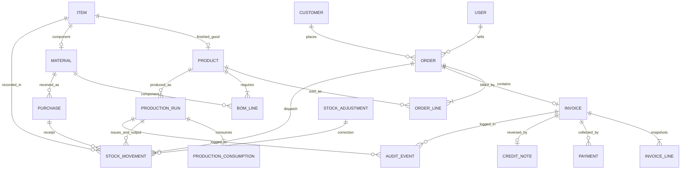

# Design note — order to audit

This note is intentionally short enough to print in two pages. See the README for commands and benchmark steps.

## ER sketch

## Rules and assumptions

- `Item` unifies product and material stock. Every posted movement has a signed quantity, original unit, converted base quantity, date, and linked source document. Balance is the sum of base quantities; draft documents do not change it. Posting checks stock, forbids backdated cost changes, and is transactional/idempotent.
- The benchmark BOM is per 200-packet batch: 40 kg flour, 10 L oil, 1.2 kg spice, 200 pouches, 10 cartons. Conversion supports kg/g, L/mL, and packet/carton using the product's 20 packets per carton. Actual wastage is part of issued quantity, not an extra issue.
- Materials use moving weighted average cost in base units. Purchase receipts enter at actual rate. Production issues snapshot their unit and extended cost; later purchases cannot rewrite a run. Yield and consumption alert when absolute variance exceeds 3%.
- Invoice numbers are per April–March financial year. Invoice lines snapshot name, HSN, price, GST rate and tax. Intra-state sales split GST into CGST/SGST; interstate uses IGST; each component rounds to paise. Issued invoices are immutable in the app. Full credit notes preserve the invoice and reverse its amounts; they do not imply a stock return.
- Dates in reports are inclusive. Stock opening uses movements before the start. Outstanding at the end includes older unpaid invoices. Ageing is based on due date, or invoice date if absent.

## Review and known gaps

Demo logins are `factory_admin`, `production_supervisor`, `salesman_a`, and `salesman_b`, all with password `BenchmarkDemo2026!`. Replace these before external access. New signups await admin approval. The seed omits real GSTIN/HSN values; enter the company's and product's actual identifiers before invoicing. Tests use illustrative values.

This is a prototype: no partial credit notes, paid-invoice refunds, automated returned-goods workflow, purchase input-GST capture, digital signing, e-invoicing, or GST return submission. Application audit events record user and time for posting/correction actions after the Day 4 migration; database administrators can still alter records outside the app, so production use requires database access controls and external backups/audit retention.
